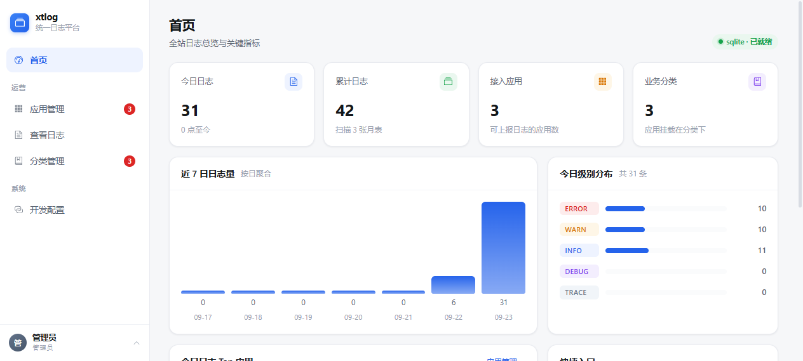
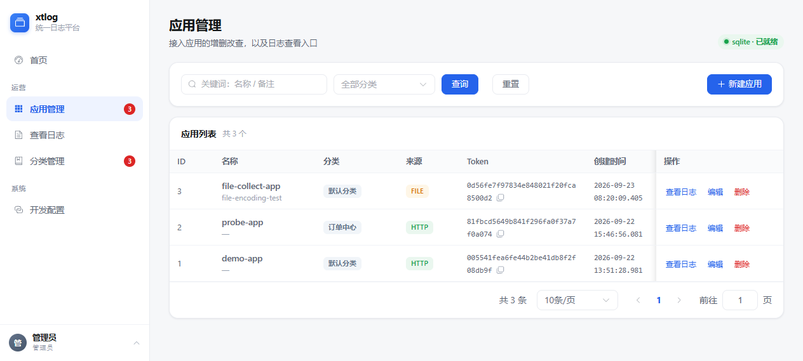
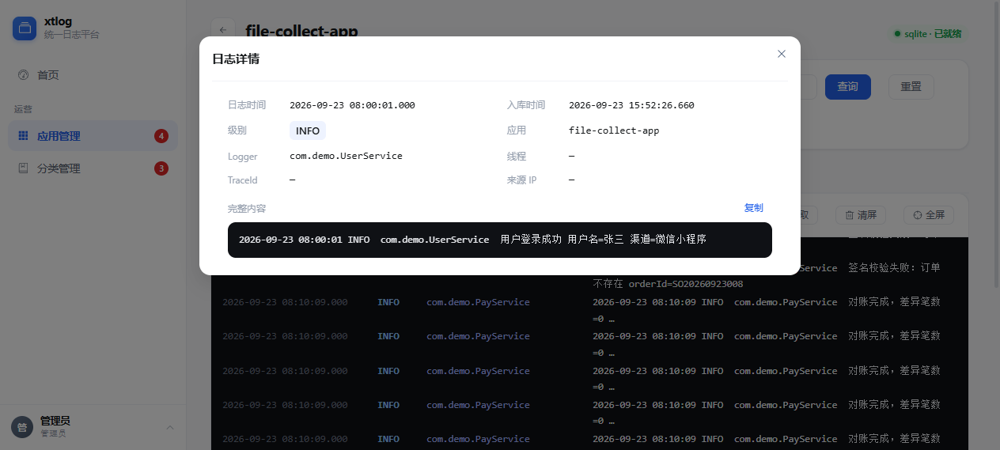
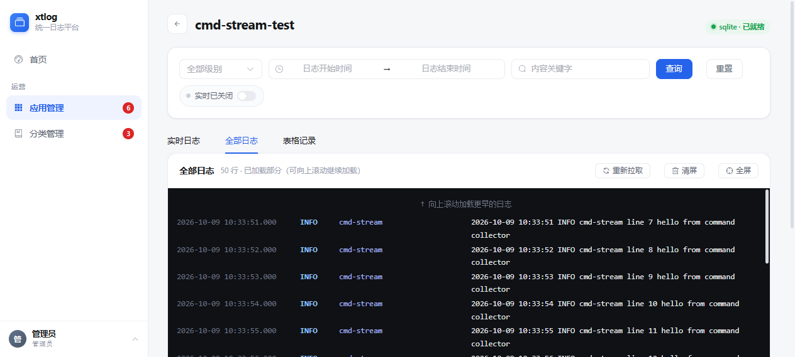
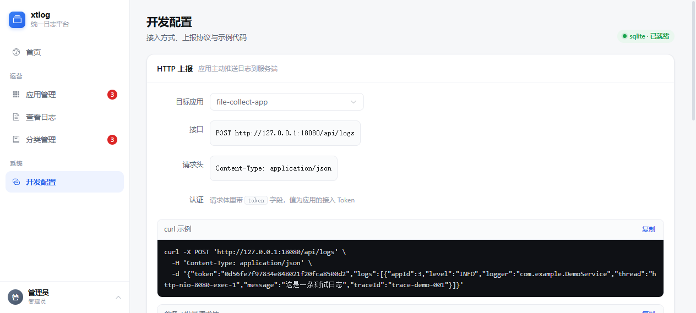

# xtlog-server

**轻量统一日志服务：一处接入，多来源汇聚，集中查看。**

对标 ELK / Graylog / Loki 的**轻量单机替代品** —— 不需要 Elasticsearch、不需要容器、不需要学查询语法。
一个 jar 跑起来，建个应用、配个路径，日志就能看了。

| | ELK 全家桶 | xtlog-server |
|---|---|---|
| 部署 | ES + Logstash + Kibana，内存 4G 起 | 单个 jar + 一个 db 文件，512M 能跑 |
| 上手 | 要学 Lucene 语法 | 建个应用、配个路径，点开就能看 |
| 对象 | 中大型团队专业运维 | 中小团队 / 个人开发者 / 多语言小项目群 |

---

## 功能特性

- **四种日志来源**
  - `HTTP` —— 应用主动上报（JSON，单条/批量），跨语言通用
  - `FILE` —— 服务端按字节偏移增量跟随日志文件，支持轮转与多行堆栈合并
  - `CMD` —— 服务端常驻执行一条 shell 命令，把输出当日志流（如 `journalctl -u game.service -f -o short-iso`）
  - `xtlog-client` —— 独立二进制，装在**别的机器**上采集后推送过来（远程采集场景）
- **不挑日志格式**：文本日志通吃，**不限于 Spring Boot / Logback**。内置多格式时间戳识别（Java/ISO8601、`nginx error` 的 `2026/10/10 09:15:32`、`nginx access` 的 `[10/Oct/2026:09:15:32 +0000]`、syslog 的 `Oct 10 09:15:32` 等），能正确切分条目、提取级别与时间，Nginx 等日志每行成为独立记录而不会糊成一团
- **实时跟随**：SSE 长连接推送，日志控制台块状布局（时间/级别/logger/IP 一行 + message 换行 + 级别色条），支持暂停、清屏、全屏
- **历史检索**：时间窗 + 级别 + 关键字 + 应用，表格分页，双击看详情（含多行堆栈、traceId、来源 IP）
- **来源 IP**：每条日志记录来源机器，微服务多实例场景下能分清是哪台机器打的
- **分类管理**：树形分类，按业务线/环境组织应用
- **零外部依赖**：自带 SQLite 驱动，默认 `data/xtlog.db`（WAL）；需要 MySQL / PostgreSQL 时丢个驱动 jar 进 `drivers/` 即可
- **按月分表**：日志表 `xt_log_entry_YYYYMM`，历史查询自动 UNION，无需手工维护

---

## 界面

| 首页概览 | 应用管理 |
| --- | --- |
|  |  |

| 日志控制台（实时 + 全部） | 日志详情 |
| --- | --- |
|  |  |

| 命令采集器配置 | 开发配置（接入示例） |
| --- | --- |
|  |  |

---

## 快速开始（直接用部署包）

从 `dist/` 取 `xtlog-server-0.0.1.zip`（或执行打包脚本自己生成），解压即可用：

```bash
unzip xtlog-server-0.0.1.zip && cd xtlog-server-0.0.1

# Windows
bin\start.bat          # 前台，Ctrl+C 结束
bin\start-bg.bat       # 后台，PID 写进 data\xtlog.pid
bin\stop.bat

# Linux / macOS
chmod +x bin/*.sh
bin/start.sh
```

- 访问 **http://localhost:18080**
- 默认管理员 `admin / admin123`（**首次登录后请在「个人中心」改密码**）
- Linux 生产环境推荐 systemd 托管：`sudo cp service/xtlog.service /etc/systemd/system/ && sudo systemctl enable --now xtlog`

> 完整的部署、配置、运维说明见 **[deploy/README.md](deploy/README.md)**。

---

## 从源码运行 / 开发

### 环境

- JDK 8+（源码按 1.8 编译，推荐 JDK 17 运行）
- Maven 3.6+、Node.js 18+
- **xtboot 0.0.1**（自研零依赖框架，是本项目的后端底座，需先安装到本地 Maven 仓库）

### 构建

```bash
# 1) 前端（产物直接输出到 src/main/resources/static，mvn package 时自动进 jar）
cd web
npm install
npm run build          # 开发调试时用 npm run dev（端口 3000，已代理 /api 到 18080）

# 2) 后端 fat jar
cd ..
mvn -s _mvn-settings.xml -DskipTests clean package
# 产出 target/xtlog-server.jar（包含后端 + 前端静态资源 + 全部依赖）
```

> `_mvn-settings.xml` 是内网/离线环境用的 settings（本地仓库 `D:/app/software_delop/maven/maven-repo` + aliyun 镜像）。
> 若你的 Nexus/中央仓库可直连，直接 `mvn -DskipTests clean package` 即可。

### 运行

```bash
java -jar target/xtlog-server.jar
# 控制台出现 "started on port: 18080" 后访问 http://localhost:18080
```

常用环境变量：

| 变量 | 说明 |
| --- | --- |
| `XTLOG_DATA_DIR` | 数据目录（默认安装目录下 `data/`） |
| `XTLOG_HOST_IP` | 手动指定「本机 IP」，FILE/CMD 采集写入日志的 `src_ip`（多网卡判断不准时用） |
| `JAVA_OPTS` | JVM 参数，如 `-Xmx1g` |

### 组装部署包

```bash
sh scripts/build-dist.sh      # Linux / macOS
scripts\build-dist.bat        # Windows
# 产出 dist/xtlog-server-<ver>/ 与压缩包
```

---

## 目录结构

```
xtlog-server/
├── src/main/java/top/xtcoder/xtlog/    # 后端（Java + xtboot）
│   ├── XtLogApplication.java           # 启动入口（@XtBootApplication）
│   ├── config/                         # 数据源、表结构迁移、初始化鉴权
│   ├── controller/                     # App / Category / Log / Ingest / Auth / Stats / Setup
│   ├── ingest/                         # 采集与落库：FileCollector、CommandCollector、
│   │                                   #   LogTextIngestor、IngestQueue、LogBatchWriter、LogBroadcast
│   ├── service/                        # AppService、UserService
│   └── util/HostAddresses.java         # 本机 IP 打分优选（避开 WSL/Docker 虚拟网卡）
├── src/main/resources/static/          # 前端构建产物（vite outDir，不要手改）
├── web/                                # 前端（Vue 3 + Element Plus + Vite）
│   └── src/views|components|api|store|router|styles
├── client/                             # 子项目：xtlog-client（Rust，远程采集推送器）
├── deploy/                             # 部署骨架：bin / config / drivers / service / README
├── scripts/                            # 部署包组装脚本
├── docs/                               # 规划方案、xtboot 改造清单、截图
├── dist/                               # 打包产出（gitignore）
└── data/                               # 运行期数据（SQLite 库，gitignore）
```

---

## 接入日志

### 1. HTTP 上报（推荐，跨语言通用）

在「应用管理」新建应用拿到 **token**：

```bash
curl -X POST http://localhost:18080/api/logs \
  -H "Content-Type: application/json" \
  -d '{"token":"<应用token>","level":"ERROR","logger":"com.svc.Gateway","message":"网关超时","srcIp":"10.0.0.21"}'
```

批量上报用 `logs: [...]` 数组。字段：`token`、`level`、`logger`、`thread`、`traceId`、`srcIp`、`timestamp`（毫秒，**建议传**，决定落在哪个月表）、`message`。

### 2. FILE / CMD（服务端主动采）

在应用编辑页选来源类型，填文件路径或命令即可。注意：这两种采集发生在 **xtlog 服务所在机器**。

### 3. xtlog-client（别的机器上的日志）

```bash
./xtlog-client --config=config.json
```

```json
{
  "server": "http://192.168.1.10:18080",
  "stateFile": "./xtlog-client.state",
  "collectors": [
    { "name": "订单服务", "token": "应用Token", "appId": 12, "type": "file",
      "paths": ["/var/log/order/app.log"], "encoding": "utf8" },
    { "name": "游戏服务", "token": "应用Token", "appId": 13, "type": "cmd",
      "command": "journalctl -u game.service -f -o short-iso" }
  ]
}
```

`collectors` 是数组，每项对应 xtlog 里的一个应用。客户端本地解析级别/时间/logger/线程后再上报，界面显示与服务端自采一致；`stateFile` 记录**文件采集**的读取偏移（仅 `file` 采集器使用），重启不重复也不丢日志，相对路径按启动时的工作目录解析。

> 完整字段说明见 **[client/README.md](client/README.md)**；远程采集的三种方案选型见 [deploy/README.md §5.2](deploy/README.md)。

### 关于「来源 IP」

| 采集方式 | `src_ip` 来源 |
| --- | --- |
| HTTP | 上报端通过 `srcIp` 字段自带（微服务各实例填本机 IP） |
| FILE / CMD | xtlog 服务所在机器的 IP |
| xtlog-client | 被采集机器的 IP（自动探测出口 IP，可在配置里写死） |

FILE/CMD 的「本机 IP」由 `HostAddresses` **打分优选**得出（网段 192.168 > 10 > 172.16~31，虚拟网卡/WSL/Docker 关键字扣分，出网路由命中加分），避免拿到 `172.27.0.1`（WSL）这类地址。启动时控制台会打印选中结果与候选得分，也可通过 `XTLOG_HOST_IP` 或 `-Dxtlog.host.ip=` 手动指定。

---

## 技术栈

| 层 | 选型 |
| --- | --- |
| 后端 | Java 8+，自研零依赖框架 **xtboot**（NIO HTTP / ORM / 调度 / 配置），maven-shade 打 fat jar |
| 前端 | Vue 3（`<script setup>`）+ Element Plus + Vite，产物挂在 `/static` 下由后端托管 |
| 存储 | SQLite（默认，WAL，按月分表）；MySQL / PostgreSQL 可选（驱动丢 `drivers/`） |
| 实时 | SSE（`/api/logs/stream`） |
| 客户端 | Rust（serde / chrono / encoding_rs），单二进制，零运行时依赖 |

主要接口：

| 方法 | 路径 | 说明 |
| --- | --- | --- |
| POST | `/api/logs` | 日志上报（单条 / 批量） |
| GET | `/api/logs` | 日志检索（时间窗、级别、关键字、分页） |
| GET | `/api/logs/stream` | 实时日志 SSE |
| GET/POST/PUT/DELETE | `/api/apps` | 应用管理 |
| GET/POST/PUT/DELETE | `/api/categories` | 分类管理 |
| GET | `/api/stats/overview` | 概览统计 |
| POST | `/api/auth/login` · `/api/auth/logout` | 登录 / 登出 |
| GET/POST | `/api/setup` | 初始化/数据源配置 |

---

## 运维提示

- 会话存在进程内存中，服务重启后需重新登录（预期行为）。
- 日志写入是异步批量的（约 500ms 一批），`kill -9` 会丢最后一批，请走 `bin/stop.*` 优雅停机。
- SQLite 数据**不要放网络盘**（NFS/SMB），WAL 依赖文件锁。
- 备份直接拷整个 `data` 目录（连 `-wal` / `-shm` 一起，或先优雅停机）。
- 改了前端/后端后，浏览器需 **Ctrl+F5** 强刷才能看到新资源。

---

## 文档索引

| 文档 | 内容 |
| --- | --- |
| [deploy/README.md](deploy/README.md) | 部署、systemd、配置、接入、远程采集、来源 IP、运维 |
| [client/README.md](client/README.md) | xtlog-client 用法与全部配置字段 |
| [docs/xtlog-server-规划方案.md](docs/xtlog-server-规划方案.md) | 产品定位、功能矩阵、架构设计 |
| [docs/xtboot-改造清单.md](docs/xtboot-改造清单.md) | 自研框架 xtboot 的能力改造记录 |

## 路线图 / 待办

- [ ] 告警规则（关键字 / 级别 / 频率，静默窗口，Webhook）
- [ ] 日志删除与导出 API
- [ ] journald `-o json` 的 PRIORITY → 级别映射
- [ ] xtlog-client 支持 https（当前需 nginx 做 TLS 终结）
- [ ] xtlog-client 的 Linux 预编译二进制与 systemd 守护示例
